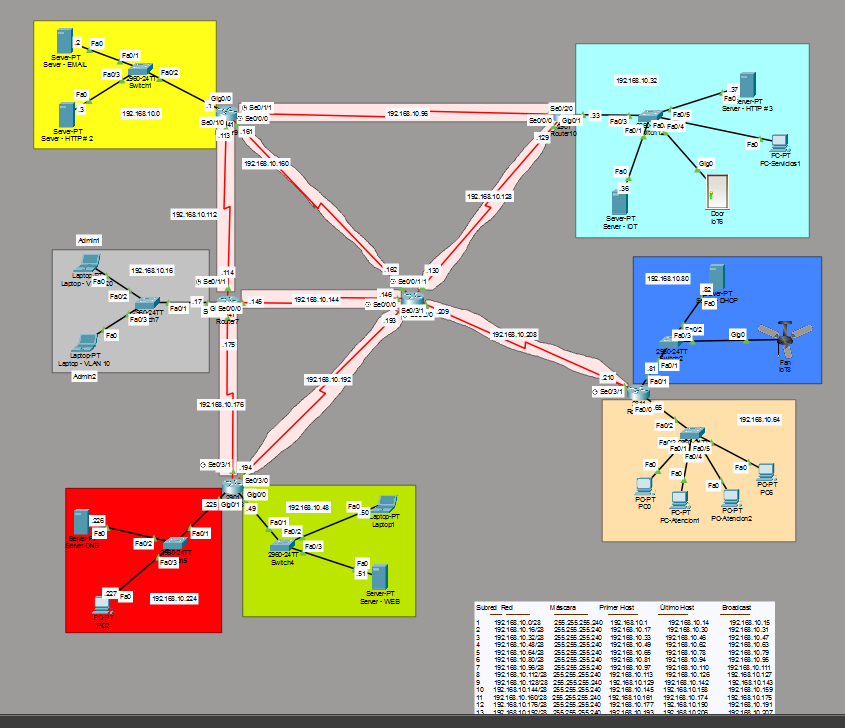
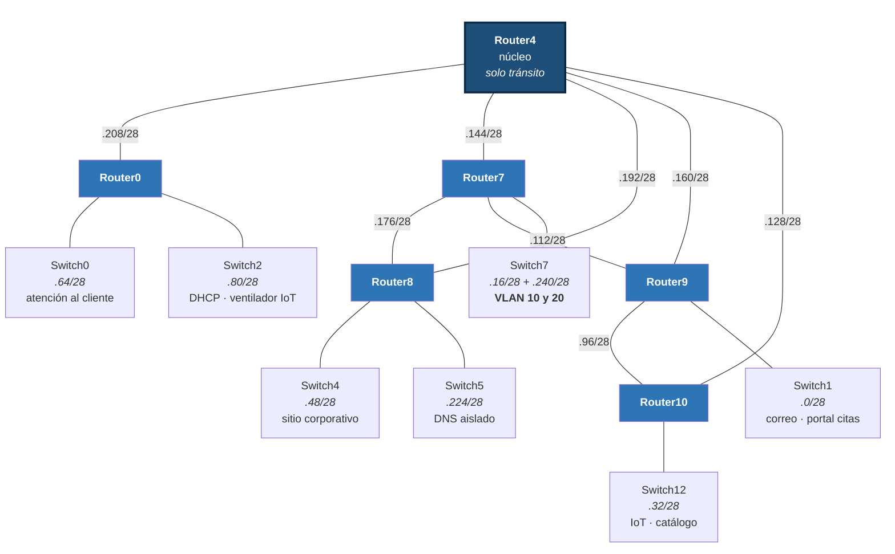

# Diseño e implementación de una red empresarial

Red corporativa completa para **Escandalosos S.A.**, un hospital veterinario ficticio en San José,
Costa Rica. Simulada en Cisco Packet Tracer: 34 dispositivos, enrutamiento dinámico con caminos
redundantes, segmentación con VLAN y cinco servicios de red funcionando de forma integrada.

> **Proyecto académico.** Trabajo final del curso de Redes, Ingeniería Informática, Universidad
> Latinoamericana de Ciencia y Tecnología (ULACIT), Costa Rica. Agosto de 2026. La empresa del caso
> es ficticia y toda la implementación está simulada — no hubo despliegue en hardware ni cliente real.

---

## El problema

La clínica tiene cuatro áreas que manejan información distinta y no deberían compartir tráfico:
administración, atención al cliente, servicios y laboratorio. Necesitaba además tres sitios web
internos, correo entre áreas, asignación automática de direcciones y control remoto de dispositivos
en zonas restringidas.

El reto no era configurar cada servicio por separado, sino que todos funcionaran **sobre la misma
red enrutada** y se pudiera demostrar.

---

## Topología



Cada zona de color corresponde a una subred distinta. Las líneas rojas entre los routers del centro
son los enlaces seriales punto a punto, cada uno con su propia subred etiquetada. La tabla que
aparece abajo a la derecha es el esquema de subneteo, anotado sobre el propio lienzo.

El mismo diseño, en esquema:



**Núcleo y borde.** El router central no tiene ninguna red de usuarios: se dedica exclusivamente a
mover tráfico entre los cinco routers de borde. Los enlaces adicionales entre routers de borde
(R7–R8, R7–R9, R9–R10) forman una **malla parcial**, de modo que la mayoría de los segmentos tiene
más de un camino disponible.

---

## Direccionamiento

Bloque **192.168.10.0/24** dividido en **16 subredes /28**, tomando prestados cuatro bits de la
porción de host. **Máscara única `255.255.255.240` en toda la red.**

| Subred | Rango útil | Asignación |
|---|---|---|
| `192.168.10.0/28` | .1 – .14 | Correo y portal de citas |
| `192.168.10.16/28` | .17 – .30 | **VLAN 10** — administración |
| `192.168.10.32/28` | .33 – .46 | Servidor IoT, catálogo y servicios |
| `192.168.10.48/28` | .49 – .62 | Sitio corporativo y laboratorio |
| `192.168.10.64/28` | .65 – .78 | Atención al cliente |
| `192.168.10.80/28` | .81 – .94 | Servidor DHCP y ventilador IoT |
| `192.168.10.96/28` | .97 – .110 | Enlace Router9 – Router10 |
| `192.168.10.112/28` | .113 – .126 | Enlace Router7 – Router9 |
| `192.168.10.128/28` | .129 – .142 | Enlace Router4 – Router10 |
| `192.168.10.144/28` | .145 – .158 | Enlace Router4 – Router7 |
| `192.168.10.160/28` | .161 – .174 | Enlace Router4 – Router9 |
| `192.168.10.176/28` | .177 – .190 | Enlace Router7 – Router8 |
| `192.168.10.192/28` | .193 – .206 | Enlace Router4 – Router8 |
| `192.168.10.208/28` | .209 – .222 | Enlace Router0 – Router4 |
| `192.168.10.224/28` | .225 – .238 | DNS y administración de red |
| `192.168.10.240/28` | .241 – .254 | **VLAN 20** — atención al cliente |

Siete zonas con equipos, dos VLAN y ocho enlaces punto a punto. **Las 16 subredes quedaron en uso.**

---

## Qué se implementó

### Enrutamiento dinámico — OSPF

Proceso 1, área 0, en los seis routers. Todo el bloque se anuncia con una sola sentencia gracias a
la máscara comodín:

```
router ospf 1
 network 192.168.10.0 0.0.0.255 area 0
```

**Cero rutas estáticas.** Los seis routers aprenden las dieciséis subredes por el protocolo. Como la
topología tiene caminos redundantes, la tabla de ruteo muestra destinos con dos rutas de igual costo:

```
O    192.168.10.0/28 [110/129] via 192.168.10.177, Serial0/3/1
                     [110/129] via 192.168.10.193, Serial0/3/0
```

### VLAN y enlace troncal

Dos VLAN sobre un mismo switch físico, con **un único enlace troncal** 802.1Q hacia el router.

```
Port        Mode    Encapsulation  Status      Native vlan
Fa0/1       on      802.1q         trunking    1

Port        Vlans allowed and active in management domain
Fa0/1       1,10,20
```

El enrutamiento entre VLAN se resuelve con **router-on-a-stick**: la interfaz física dividida en dos
subinterfaces, cada una con su encapsulación y su dirección de gateway.

```
interface GigabitEthernet0/0.10
 encapsulation dot1Q 10
 ip address 192.168.10.17 255.255.255.240
 ip helper-address 192.168.10.82
```

### DHCP con relay entre redes

Un servidor centralizado sirviendo **cinco zonas distintas**. El mensaje DISCOVER es broadcast y un
router no lo reenvía entre redes, así que cada interfaz que da hacia una zona con clientes lleva
`ip helper-address` apuntando al servidor: el router convierte esa difusión en un mensaje dirigido.

Los rangos arrancan saltando las direcciones ya ocupadas de forma fija. En la zona del servidor IoT,
por ejemplo, el grupo empieza en `.38` porque antes están el servidor IoT y el sitio del catálogo.

### Servicios de aplicación

| Servicio | Detalle |
|---|---|
| **DNS** | 6 registros tipo A resolviendo todos los servicios de la empresa |
| **HTTP** | 3 sitios en 3 segmentos distintos — institucional, portal de citas y catálogo |
| **Correo** | SMTP y POP3, dominio propio, 5 cuentas repartidas por área |
| **IoT** | Servidor de registro con 2 dispositivos controlables en remoto |

Los tres sitios web están **a propósito en segmentos distintos**: así cada acceso obliga al tráfico a
cruzar el núcleo y se convierte en una prueba real de enrutamiento.

---

## Decisiones de diseño

**Máscara única en lugar de VLSM.** Los enlaces entre routers solo necesitan dos direcciones, así que
una máscara /30 habría ahorrado espacio. Se descartó a propósito: en una organización pequeña sin
administrador dedicado, que todo segmento tenga el mismo tamaño y las mismas reglas vale más que el
ahorro de direcciones. Y las dieciséis subredes alcanzaron justo, así que el desperdicio no fue real.

**Migración de rutas estáticas a OSPF.** El proyecto arrancó con enrutamiento estático. Con seis
routers y dieciséis subredes eso significaría mantener decenas de rutas por equipo y tocar los seis
cada vez que se agrega una red. Con OSPF se anuncia una vez y el protocolo propaga; además recalcula
solo si un enlace cae.

**DNS aislado en su propio segmento.** El servicio del que depende toda la operación no comparte
dominio de difusión con el tráfico de usuarios. Si el DNS falla, ningún nombre resuelve y la red deja
de ser usable aunque el enrutamiento esté perfecto.

**Router de núcleo sin redes de usuario.** Separa la carga de tránsito de la carga de acceso: un
problema en una zona de usuarios no afecta la capacidad de tránsito del resto.

---

## Limitación conocida

Cinco de los seis routers tienen más de un camino hacia el resto de la red. **Uno no.** Se conecta al
núcleo por un único enlace serial, así que si ese enlace cae, sus dos zonas quedan aisladas.

En una red de producción se resolvería agregando un segundo enlace hacia otro router de borde. No se
implementó porque consumiría una subred adicional y las dieciséis ya estaban asignadas — hacerlo
obligaría a rediseñar el esquema de direccionamiento completo. Queda identificado como la mejora
prioritaria.

Se documenta en lugar de omitirse: reconocer un punto débil y saber cómo corregirlo dice más que
presentar un diseño sin fisuras.

---

## Validación

La red se probó con tráfico real dentro del simulador, buscando que cada requisito tuviera al menos
una prueba que lo respaldara:

- Conectividad entre equipos de zonas opuestas, verificando que los paquetes crucen el núcleo
- `show ip route` — rutas aprendidas por OSPF, ninguna estática
- `show ip ospf neighbor` — adyacencias en estado FULL
- `show interfaces trunk` — el troncal activo con ambas VLAN
- Carga de los tres sitios **por nombre de dominio** desde segmentos distintos
- Envío y recepción de correo entre áreas
- Asignación dinámica comprobada en los clientes de las VLAN
- Control remoto de los dispositivos IoT desde una tercera zona

---

## Contenido del repositorio

```
├── packet-tracer/
│   └── escandalosos-red-final.pkt    Topología completa y funcional
├── docs/
│   └── documento-tecnico.docx        Documento técnico formal (~4.100 palabras)
└── evidencia/
    └── running-configs.txt           show running-config de los 13 equipos
```

Para abrir el `.pkt` hace falta [Cisco Packet Tracer](https://www.netacad.com/cisco-packet-tracer)
versión 8.2 o superior.

---

## Equipo

Proyecto grupal del curso de Redes, ULACIT:

- Daniel Fernández Aguilar
- Joseth Gamboa Guzmán
- Franco Ricci Morales
- Marcela Valverde Lara
- Kevin Villalobos Obando

Profesor: José Chavarría Molina

---

## Nota sobre uso

Este repositorio se publica como material de portafolio académico. El contenido es trabajo
universitario de los cinco integrantes listados; si vas a reutilizarlo con fines académicos,
acredita al equipo.
